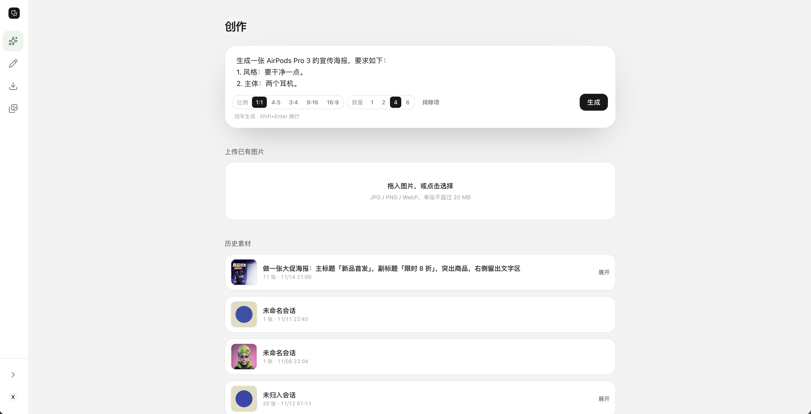
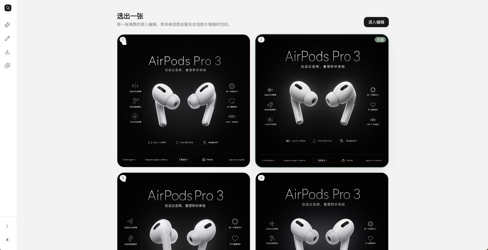
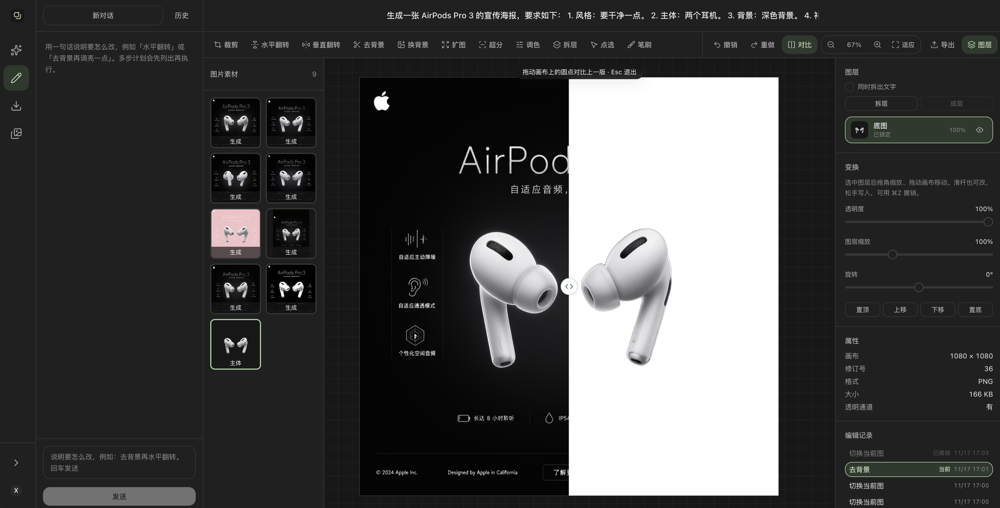
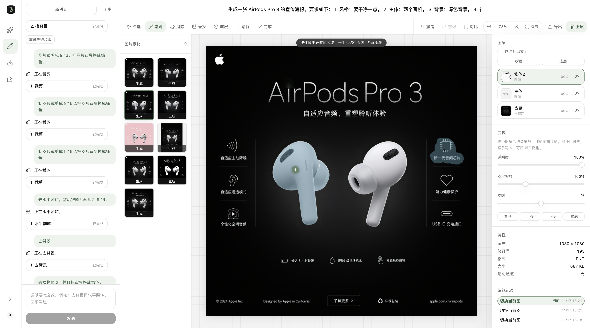
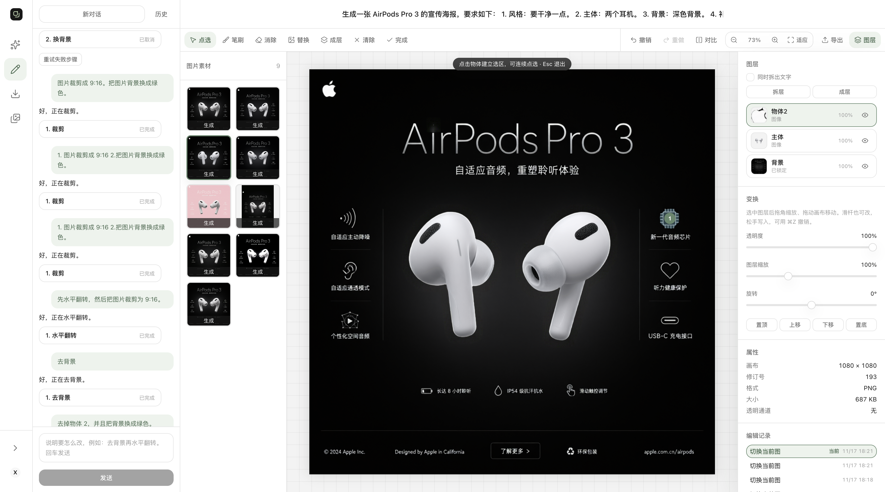
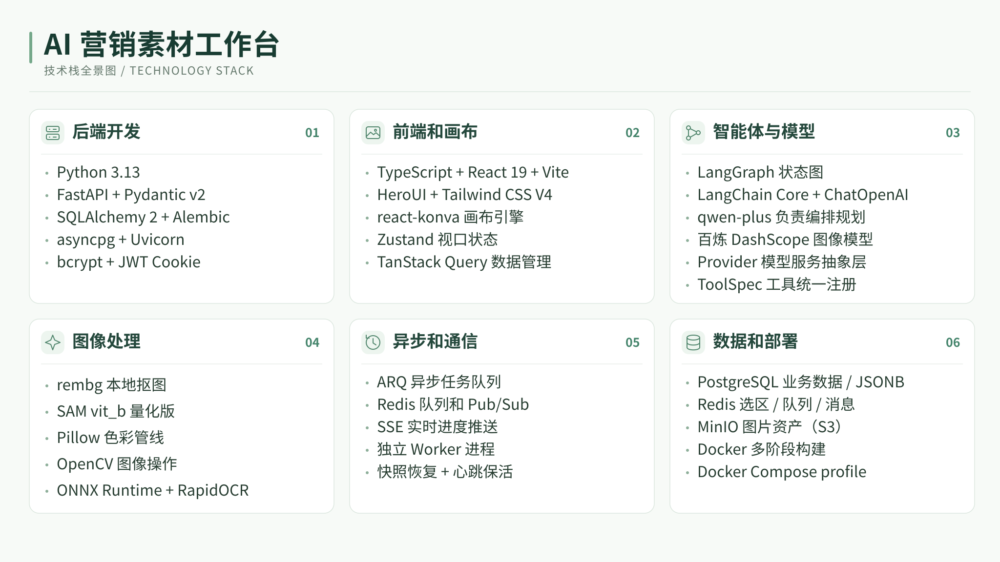

<div align="center">

# AI 营销素材工作台

基于 FastAPI + LangGraph 与 React 19 + Konva 的全栈营销素材工作台。用户输入一句自然语言，Agent 自动分析需求、规划编辑步骤，然后逐步调用工具执行——抠图、调色、区域编辑、图层拆分全部自动完成。前端提供支持缩放平移、图层文档、撤销重做的专业画布编辑器，所有长任务通过 ARQ 队列异步执行，Redis Pub/Sub + SSE 实时推送进度。

[](https://www.typescriptlang.org)
[](https://react.dev)
[](https://www.heroui.com)
[](https://konvajs.org)
[](https://tailwindcss.com)
[](https://tanstack.com/query)
[](https://zustand.docs.pmnd.rs)
[](https://pnpm.io)
[](https://vite.dev)

[](https://www.python.org)
[](https://fastapi.tiangolo.com)
[](https://www.langchain.com/langgraph)
[](https://www.sqlalchemy.org)
[](https://www.postgresql.org)
[](https://redis.io)
[](https://min.io)
[](https://docs.astral.sh/uv/)
[](https://www.docker.com)

</div>

---

从上传图片或 AI 生图开始，在同一工作台中完成背景处理、局部修改、图层编辑与导出。既可以直接使用工具，也可以让 Agent 根据自然语言生成执行计划，确认后逐步处理，并查看任务进度与编辑记录。

## ✨ 核心功能

| 功能                  | 说明                                                                                            |
| --------------------- | ----------------------------------------------------------------------------------------------- |
| 🤖 自然语言修图       | 描述修改需求，由 Agent 规划并调用修图工具；支持查看计划、确认执行、重试失败步骤与取消后续操作。 |
| 🎨 交互式画布         | 支持画布缩放和平移，以及图层移动、缩放、旋转、翻转、裁剪等手动编辑操作。                        |
| 🪄 背景处理           | 支持去除背景、替换背景，以及将主体与背景拆成独立图层。                                          |
| 🎯 选区与局部编辑     | 通过 SAM 点选或手动圈选指定区域，进行局部消除、内容替换，或将选区提取为独立图层。               |
| 🧩 图层与文字编辑     | 管理图层顺序、可见性与透明度，调整图像颜色；支持 OCR 文字拆分与文字内容编辑。                   |
| 🖼️ AI 图像生成与增强  | 支持提示词生图、扩图与超分辨率，将生成结果继续用于编辑。                                        |
| 📦 营销与批量输出     | 支持营销图生成、多尺寸交付、批量处理及打包下载。                                                |
| 🕘 编辑记录与效果对比 | 支持撤销、重做、历史记录查看与前后效果对比，保存会话中的素材和编辑状态。                        |

## 🖼️ 功能预览

### 自然语言修图

在对话框描述需求，查看 Agent 生成的计划，确认后执行修图任务：




### 交互式画布编辑器

画布缩放平移、图层文档管理、撤销重做，前后对比滑杆一拖即见修图效果：



### 智能区域选择与局部编辑

通过 SAM 点选或手动圈选确定区域，再执行局部消除或内容替换；编辑结果通过遮罩合成到原图：



### 图层拆分

将图片拆分为主体、背景及可选的 OCR 文字层，在图层面板中分别编辑。文字样式还原的限制见下文“能力边界”：



### 多步计划与人机协作

复杂需求生成带依赖关系的执行计划，支持确认执行、重试失败步骤或取消后续操作：


## 🏗️ 技术栈与架构



## 🚀 快速开始

### 环境要求

- Python 3.13 或更高版本、uv。
- Node.js 22（与 Docker 构建环境一致）、pnpm 11.23.0（与 CI / Docker 保持一致）。
- Docker 与 Docker Compose，用于启动 PostgreSQL、Redis 和对象存储。

以下各终端均从项目根目录开始执行。无需手动激活 `.venv`，使用 `uv run` 即可。

### 1. 配置

```bash
cp .env.example .env
```

已有 `.env` 时请直接检查配置，不要覆盖。默认图片服务为 Mock，可先验证页面与任务流程；用户模型 Key 的保存与使用见下文「模型 Key 与公网部署」。

### 2. 启动基础设施

```bash
docker compose up -d postgres redis minio
```

### 3. 启动后端

```bash
cd backend
uv sync --all-extras --locked --index-url https://pypi.tuna.tsinghua.edu.cn/simple
uv run alembic upgrade head
uv run python -m uvicorn app.main:app --reload --host 127.0.0.1 --port 7302
```

另开一个终端，从项目根目录进入 `backend/` 启动 Worker：

```bash
cd backend
uv run python -m arq app.worker.WorkerSettings
```

`--reload` 仅自动重启 API；修改 Worker 代码或根目录 `.env` 配置后，请手动重启对应服务。生产环境不要使用 `--reload`。

### 4. 启动前端

```bash
cd client
pnpm install --frozen-lockfile
pnpm dev
```

打开开发服务器输出的地址（默认 `http://127.0.0.1:7301`），首次使用先注册账号，再上传图片或生成图片。API 默认监听 `http://127.0.0.1:7302`，接口文档位于 `/api/docs`。

## ⚙️ 配置与能力边界

核心配置在根目录 `.env`：

| 变量                                                         | 说明                                                                                                               |
| ------------------------------------------------------------ | ------------------------------------------------------------------------------------------------------------------ |
| `IMAGE_PROVIDER`                                             | `mock` 返回本地占位图片，仅限本地开发；`dashscope` 调用真实图片模型。                                              |
| `CREDENTIAL_ENCRYPTION_KEY`                                  | 加密用户模型 Key 的 Fernet 主密钥，必填；API 与 Worker 必须一致，换值后已保存的 Key 将无法解密。                   |
| `ALLOW_PLATFORM_KEY_FALLBACK`                                | 是否允许未配置 Key 的访客回退使用平台 Key。默认 `false`，公网部署务必保持关闭。                                    |
| `DASHSCOPE_API_KEY` / `DASHSCOPE_BASE_URL`                   | 平台兜底用的 Key（仅在开关打开时生效）与模型服务地址。                                                             |
| `TEXT_TO_IMAGE_MODEL` / `IMAGE_EDIT_MODEL` / `PLANNER_MODEL` | 用户未填写模型名时的默认值，同时用于设置面板预填。                                                                 |
| `MATTING_PROVIDER`                                           | `auto` 优先使用 rembg，失败时降级；`rembg` 强制使用模型并在失败时报错；`corner` 使用简化处理，不代表真实模型效果。 |
| `MATTING_MODEL`                                              | rembg 权重名，默认 `isnet-general-use`（约 180 MB、峰值约 1 GB）；`bria-rmbg` 效果更好但需 8 GB 以上内存。 |
| `OCR_PROVIDER`                                               | `auto` 尝试使用 RapidOCR 识别文字，不可用时跳过；`none` 不拆分文字层。                                             |
| `DATABASE_URL` / `REDIS_URL` / `S3_*`                        | 数据库、任务队列与对象存储连接配置；`S3_PUBLIC_ENDPOINT` 用于浏览器访问签名图片 URL。                              |
| `JWT_SECRET` / `JWT_TTL_HOURS`                               | 登录态签名密钥与有效期；生产环境必须更换默认密钥。                                                                 |

### 模型 Key 与公网部署

模型 Key 属于**用户自己的账号配置**，不存在「一份 Key 全站共用」的默认路径：

- 登录后打开左侧账户菜单 → **模型设置**，填入自己的 DashScope（阿里云百炼）API Key 与三个模型名即可。Key 加密后存在 `users` 表，读取接口只返回尾号提示，任何时候都不会把明文返回浏览器。
- 保存时可选择先用一次 1 token 的请求验证 Key；验证失败不会覆盖原配置。同一账号的验证有 20 秒频率限制。
- 每个图片生成、编辑与对话规划任务都会按任务归属读取该账号的 Key，在任务内创建独立客户端并在结束时释放，不跨账号复用。
- 未配置 Key 的用户提交云端任务会直接返回 403，不会创建排队任务，也不会回退到平台 Key（除非显式开启 `ALLOW_PLATFORM_KEY_FALLBACK`）。
- 生产环境 `IMAGE_PROVIDER=mock` 会被拒绝：占位图只服务本地开发。
- `CREDENTIAL_ENCRYPTION_KEY` 必须是稳定的 Fernet 主密钥，API 与 Worker 共用同一个值；更换后旧 Key 需要用户重新填写。

> 公网部署检查清单：`APP_ENV=production`、`IMAGE_PROVIDER=dashscope`、`ALLOW_PLATFORM_KEY_FALLBACK=false`、`CREDENTIAL_ENCRYPTION_KEY` 已设置且已备份、`JWT_SECRET` 已更换。

### Mock 与真实模型

- **图片 Mock**：`IMAGE_PROVIDER=mock` 不调用收费图片模型，适合验证交互和任务流程，但不提供真实修图效果。
- **自然语言规划**：对话规划使用当前账号的 Key 与规划模型，同样会消耗该账号的额度。
- **真实图片处理**：将 `IMAGE_PROVIDER` 改为 `dashscope`。图片会发送到模型服务，请注意素材隐私及服务方计费规则。
- **本地视觉模型**：rembg、SAM 等能力首次使用时可能下载模型权重，耗时受网络、硬件及图片尺寸影响；图片 Mock 不会同时禁用本地视觉模型。
- **轻量流程调试**：不需要本地视觉模型时，可使用 `MATTING_PROVIDER=corner`、`OCR_PROVIDER=none`；此时抠图与点选为简化结果，不能用于评估模型质量。

### 能力边界

- **点选分割**：SAM 缓存图像特征以减少重复计算，但不保证固定响应时间或对任意物体都能准确分割；自动模式下模型失败可能返回简化选区。
- **局部编辑**：当前将图片交给编辑模型，再按选区遮罩合成结果，并非向模型直接传入遮罩的原生 Inpainting 接口。
- **OCR 文字层**：主要还原文字内容与位置，不能完整复刻原图字体、颜色与排版效果，可能需要手动调整。
- **图层拆分**：由分割、背景补全与可选 OCR 共同完成，不等同于恢复原始设计文件，结果取决于输入图片和模型效果。
- **编辑历史**：按会话维护编辑记录，不是为图片墙中的每个素材分别建立独立历史；图层移动、旋转等操作保存的是文档状态，不会每次都生成一张新图片。

## 🐳 Docker 部署与 CI/CD

### Docker 部署

在根目录准备好 `.env` 后执行：

```bash
docker compose --profile deploy up -d --build
docker compose --profile deploy exec app alembic upgrade head
```

镜像采用多阶段构建，前端产物由后端同源托管，访问 `http://localhost:7302` 即可。首次部署及包含数据库结构变更的更新均需执行迁移。

公网部署前请更换开发用密钥与数据库、对象存储凭据，配置 HTTPS，并将 `S3_PUBLIC_ENDPOINT` 设为浏览器可访问的对象存储地址；不要直接将开发配置中的基础设施端口暴露到公网。`.env` 必须包含 `CREDENTIAL_ENCRYPTION_KEY`（用户 Key 的加密主密钥，需备份），并保持 `ALLOW_PLATFORM_KEY_FALLBACK=false`；模型 Key 由各用户自行在界面中配置。

### 持续部署（CI/CD）

合并到 `main` 后，GitHub Actions 会经 Cloudflare Tunnel 自动部署到家里的一台 Mac Mini：

- `.github/workflows/ci.yml`：PR 上跑后端 ruff 检查与前端 lint / build
- `.github/workflows/deploy.yml`：`main` 触发构建、启动容器、数据库迁移与健康检查

流水线使用 GitHub 托管 runner，而不是在部署机器上运行 self-hosted runner；合并进 `main` 的代码仍会进入部署流程，需要做好分支保护、代码审核和 Secrets 权限管理。此部署流程依赖仓库维护者的基础设施配置，克隆仓库后不会自动获得部署环境。完整的一次性配置与故障排查见 [部署到 Mac Mini](docs/deploy-mac-mini.md)。

## 🗂️ 项目结构

```text
backend/
├── app/             后端应用代码
│   ├── routers/     HTTP 接口路由
│   ├── schemas/     请求和响应的数据结构
│   ├── services/    业务逻辑
│   ├── models/      数据库模型
│   ├── tools/       编辑工具的参数、注册和执行实现
│   ├── edits/       图层、像素、遮罩等底层处理
│   ├── agent/       自然语言指令转工具计划
│   ├── providers/   外部 AI 图像服务的适配
│   ├── tasks/       worker 可以执行的队列任务
│   └── eval/        图像处理效果评测
├── migrations/      数据库结构变更记录
├── tests/           自动化测试
├── scripts/         独立验证脚本
├── pyproject.toml   项目依赖和工具配置
├── uv.lock          锁定依赖版本
└── alembic.ini      数据库迁移工具配置

client/
├── public/             静态资源
├── src/
│   ├── api/            后端接口调用和接口类型
│   ├── pages/          路由对应的完整页面
│   ├── layouts/        页面公共外壳、登录访问控制
│   ├── components/     UI 组件
│   │   ├── editor/     编辑器专用组件
│   │   ├── landing/    首页专用组件
│   │   └── ui/         通用基础组件
│   ├── hooks/          可复用的 React 业务和交互逻辑
│   ├── stores/         跨组件共享的客户端状态
│   ├── lib/            工具函数、计算逻辑和业务常量
│   ├── main.tsx        应用启动入口
│   ├── App.tsx         页面路由配置
│   └── index.css       全局样式
├── index.html          HTML 入口
├── package.json        依赖和执行命令
├── pnpm-lock.yaml      依赖锁文件
├── vite.config.ts      开发和构建配置
└── tsconfig*.json      TypeScript 配置

.github/workflows/    CI（PR 校验）与 CD（合并 main 自动部署）
docs/                 部署与运维文档（部署流水线、Mac mini 常驻配置、延迟与内存诊断）
docker-compose.yml   基础设施 + deploy profile
Dockerfile           多阶段构建：前端构建 → 后端同源托管
```

## 许可证

当前仓库尚未包含 `LICENSE` 文件，原 README 中的 MIT 声明缺少对应的许可证文本。使用、修改或分发前，请核实上游项目的许可证与版权归属，并补齐适用的许可证及第三方声明。

本项目基于 [yuyuanweb/ai-picture-editor](https://github.com/yuyuanweb/ai-picture-editor) 改造而来。
